# ExoSim

**A C++ orbital simulation and visualization system.** It ingests real astronomical catalogs, propagates orbits, and computes mission-transfer opportunities, and it keeps validated physical data clearly separate from assumptions and visualization choices.

Version 0.8.0 · C++20 · OpenGL 3.3 · [MIT License](LICENSE) · [Changelog](CHANGELOG.md)

<!-- Screenshots and demo video: see "Demo" below. -->

## At a glance

- **Real data, four sources.**
  - NASA Exoplanet Archive: 6,366 planets and 47,903 stellar-host records.
  - NASA/JPL Small-Body Database: dwarf planets.
  - Hipparcos catalog: ~9,000 naked-eye stars with positions, colors, proper motions and parallaxes.
  - Washington Double Star catalog: companion-star separations.
- **Orbital mechanics.**
  - Kepler-equation propagation on JPL's elements **with their secular rates**, validated against JPL Horizons (DE441) over 1950–2050: inner planets within 18–77″.
  - A **Lambert** mission planner (3-D, arbitrary dates) with **porkchop plots** of C3, v∞ and Δv. It finds the 2020 Mars window within 2 days of Perseverance's launch.
  - **Gravity-assist chains** (patched conics, powered flybys, sphere-of-influence transitions). The optimizer rediscovers the Voyager (Earth–Jupiter–Saturn, 1977) and New Horizons (Earth–Jupiter–Pluto, 2006) launch dates.
- **Mission operations and landing.**
  - Click the spacecraft to follow it, with a fixed-tick clock running anywhere from real time to 10 days/s and stopping on mission events.
  - A sequence of events and live telemetry, including the signal delay to Earth.
  - At arrival, a simulated entry, descent and landing played back in real time. It uses closed-loop ZEM/ZEV powered-descent guidance at 20 Hz on 100 Hz physics. The simulated touchdowns match Perseverance (0.75 m/s), Apollo 11 (~12 min of powered descent) and Huygens (4.5 m/s).
- **A Milky Way map.** Scroll from 1 pc to 80 kpc: 4,668 exoplanet host stars at their real 3-D positions, over an illustrative model of the disk, bar and spiral arms, in a 2-D top-down map or a 3-D view. Click a host to open its system.
- **Validated and replayable.**
  - 181 automated checks against conservation laws, closed-form solutions, JPL Horizons, published astronomical events, real missions and real landings.
  - Whole sessions can be recorded and replayed; a state hash proves the replay matches.
  - Clean under AddressSanitizer, UndefinedBehaviorSanitizer and clang-tidy; formatting enforced in CI.
  - All shaders pass the Khronos reference compiler.
  - Writing the suite found and fixed four real defects. See [Validation](docs/VALIDATION.md).
- **Honest about uncertainty.** Every value is labeled measured, derived, estimated or illustrative, and the UI never presents a guess as a measurement. See [Data sources](docs/DATA_SOURCES.md).
- **Real-time rendering.** A CRT/vector-display aesthetic, zoom-adaptive procedural surfaces, real ring radii, and the real sky re-projected as seen from each exoplanet host.

## Main engineering contributions

| Area | What was built | Evidence |
|---|---|---|
| Propagation | Kepler solver with sign-aware Newton start and a guaranteed bisection fallback; J2000 heliocentric-ecliptic ephemeris | KEP-1…6, EPH-1…6 |
| Mission analysis | Universal-variable Lambert solver; porkchop grids; launch-window search; patched-conic gravity-assist optimizer with SOI transitions | LAM-1…19, GA-1…15, MIS-1…7 |
| Ephemeris validation | Standish elements with secular rates; error envelopes vs. JPL Horizons DE441, 1950–2050 | EPH-H0…17 |
| Software architecture | `SimulationState` changed only through `Command`s; recorded-input replay with state hashes; core library without GL; config file and structured JSON-lines logging | ENG-1…19 |
| Data engineering | Four-source ingestion (Python and C++ tools), type-safe parsing, graceful degradation, positional cross-match of 150k double stars in under 0.5 s | DAT-1…5, [Architecture → Performance](docs/ARCHITECTURE.md#performance) |
| Astrometry | Equatorial→ecliptic frame alignment; parallax re-projection of the sky from other stars; linear proper motion from epoch J1991.25 | [Architecture → Frames](docs/ARCHITECTURE.md#time-systems-and-reference-frames) |
| Flight software patterns | Fixed-rate GNC loop (100 Hz physics, 20 Hz guidance, zero-order hold), phase sequencer, ZEM/ZEV guidance, limit monitors, deterministic fixed-tick clock, telemetry export | FSW-1…24 |
| Astrometry at Galactic scale | IAU J2000 equatorial→Galactic transform; host-star positions from RA/Dec + distance | GAL-1…11 (matches the Archive's l, b to 1e-5°) |
| Rendering | GL 3.3 renderer with procedural 3-D-noise surfaces, bump shading, real-radius ring bands, a point-sprite star catalog, point-cloud galaxy layers, and a CRT post-process | 15/15 shaders validated |

## Validation summary

| Check | Result |
|---|---|
| Kepler invariants, e = 0 … 0.99 | Worst relative error ~1e-7 |
| Planet positions vs. JPL Horizons, 1950–2050 (max angle) | Mercury–Mars 18–77″; Jupiter/Saturn ~550″; Uranus/Neptune 58–110″ |
| Mars / Jupiter / Saturn opposition times vs. published | 5 / 69 / 153 min |
| 2026 equinox vs. published (precession-corrected) | 15 min |
| Lambert solver vs. Curtis Example 5.2 | < 0.0001 km/s |
| 2020 Mars window vs. Perseverance | Launch 2020-08-01 (real 07-30), 209 days (real 203) |
| Voyager-era Earth–Jupiter–Saturn chain | Launch 1977-09-05 (Voyager 1: 09-05) |
| Recorded session replay | Final state hash identical; tampered recording detected |
| Hohmann time and Δv vs. closed form | Exact to reported precision |
| Planned trajectory end point vs. target | < 2e-11 AU |
| Malformed / missing / mistyped input | Handled without crashing |
| Mars / Moon / Titan touchdown speed vs. Perseverance / Apollo / Huygens | 0.75 / 0.9 / 4.45 m/s (published 0.75 / ~0.9 / ~4.5) |
| Landing simulation re-run | Bit-for-bit identical |

Full table, methods, tolerances, and what is **not** yet validated:
[docs/VALIDATION.md](docs/VALIDATION.md).

## Platforms

| Platform | Status |
|---|---|
| Windows 10/11, Visual Studio 2022, vcpkg | Primary. Builds and runs; portable zip built by CI. |
| Linux (GCC 13) | Compiles, links, and passes the test suite and sanitizers; rendering not exercised |
| macOS | Untested; likely needs the GLFW forward-compatible core-profile hint |

## Download and run (no build needed)

Each tagged release on GitHub has a portable Windows zip:
`ExoSim-<version>-win64.zip` under **Releases**.

1. Extract the whole folder and double-click `ExoSim.exe`. There is
   nothing to install: libraries and the C++ runtime are linked in, and
   the zip ships a real data snapshot.
2. The build is unsigned, so Windows SmartScreen will warn. Choose
   *More info → Run anyway*.
3. `ExoSim.exe --selftest` checks the install without opening a window.

Requirements: Windows 10/11 x64 with OpenGL 3.3.

## Build and run (Windows)

1. **Install vcpkg once:**
   ```powershell
   git clone https://github.com/microsoft/vcpkg C:\vcpkg
   C:\vcpkg\bootstrap-vcpkg.bat
   C:\vcpkg\vcpkg.exe integrate install
   ```
2. **Fetch data** (optional; Sol works without it):
   ```powershell
   cd ExoSim\data
   pip install certifi          # recommended; fixes TLS verification for VizieR on some installs
   python fetch_exoplanets.py
   ```
   The C++ `FetchData` target does the same job. Useful flags for either
   tool: `--star-vmag-limit 8.0` (fetch ~40k stars instead of 9k),
   `--skip-star-catalog`, `--skip-double-stars`.
3. **Build:** in Visual Studio, File → Open → Folder → `ExoSim`. vcpkg
   restores the dependencies automatically. Then select `ExoSim.exe` and
   press F5.
4. **Test:** build `ExoSimTests`, then run `ctest --output-on-failure`.

**Portable package locally** (same settings CI uses). Set `VCPKG_ROOT`
(e.g. `C:\vcpkg`), then in a Developer PowerShell for VS 2022:
```powershell
cmake --preset windows-portable
cmake --build --preset windows-portable
ctest --preset windows-portable
cd build\windows-portable; cpack -C Release   # -> ExoSim-0.8.0-win64.zip
```
The first configure builds every dependency statically, so it's slow once.

If a data file is missing, only the feature it feeds is disabled. The
console states which one.

## Using it

- **Navigate:** left-drag to orbit the camera, scroll to zoom. Pick a system from the searchable list; filter by planet count.
- **Inspect:** "Inspect Planet" or "Inspect <moon>" opens a close-up with physical data and labeled estimates. Zooming in reveals more surface detail.
- **Plan a mission (Sol):** in the Mission Planner, choose a vehicle and destination, then "Plan next launch window". This shows the launch and arrival dates, transfer time, Δv, arrival speed and window cadence. "Jump to launch" plays the trajectory.
- **Fly the mission:** the Flight Director window shows mission elapsed time, phase, the next event, live telemetry and the sequence of events. Click the rocket (or "Follow spacecraft") to ride along. Time warp runs from 1× (real time) to 10 days/s; with "warp to events" on, the clock stops at launch and again at the start of the landing.
- **Watch the landing:** at arrival (or with "Skip ahead to the landing") the Landing view opens. It plays entry, parachutes and powered descent in real time, with telemetry, strip charts and limit monitors. Drag to orbit the chase camera; scroll to zoom. Both windows can export telemetry as CSV.
- **Trajectory design:** "Porkchop plot" maps transfer cost over launch and arrival dates; click any cell to fly that transfer. "Gravity assists" plans Earth–Jupiter–Saturn and other flyby chains, with sphere-of-influence entry and exit on the timeline.
- **Milky Way map:** "Milky Way map" in the control window. Scroll to zoom at the cursor (1 pc to 80 kpc); drag to pan (2-D) or orbit (3-D); right-drag pans in both. Search for a host star, click one to see its distance and Galactic coordinates, and "Open system" to fly there.
- **Record and replay:** "Record" in the Session window saves your inputs to `recordings/`; run with `--replay <file>` to watch it again, or `--verify-replay <file>` to check headlessly that it reproduces the same final state.
- **Settings:** copy `exosim.example.json` to `exosim.json` next to the exe to set the window size, data and output folders, default speed and logging. Unknown keys or bad values are reported and ignored.
- **Controls:** simulation speed and date ("Today" resets it), logarithmic distance scaling, star-size exaggeration, and a sky-epoch slider that shows stellar proper motion over ±100,000 years.

## Demo

Screenshots from the Windows build (v0.6.0) and the deterministic screenshot mode (v0.7.0, v0.8.0). A demo video is still to come.

### The Milky Way map (0.8)

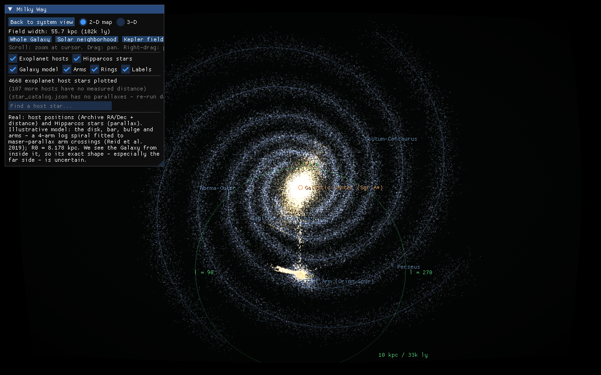

*The whole Galaxy, top-down, Galactic Center up. The orange points are
real exoplanet hosts. The streak from the Sun toward the bulge is the
microlensing surveys, and the plume toward l ≈ 76° is Kepler's field. The
disk, bar and arms are an illustrative model (labeled in the app).*

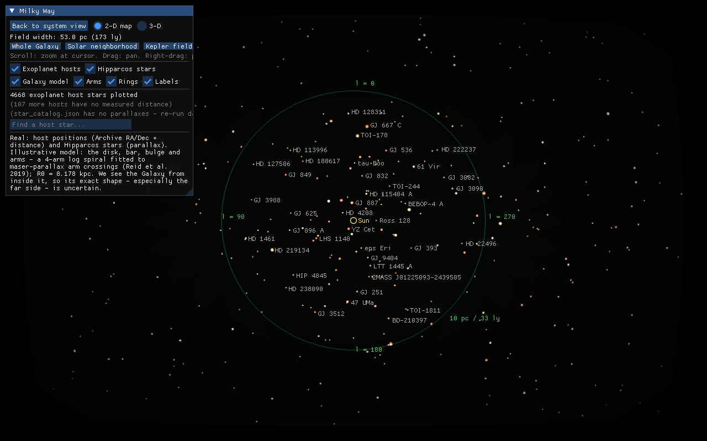

*Zoomed to the solar neighborhood (10 pc ring): every labeled star has
known planets.*

### Porkchop plot (0.8)

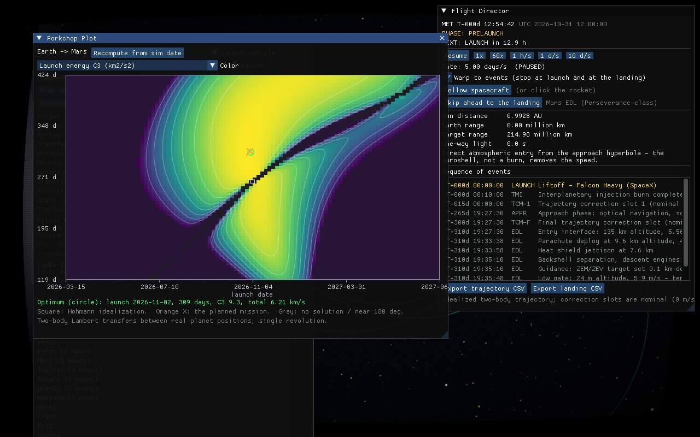

*Earth→Mars transfer cost over launch and arrival dates, with Type I and
Type II lobes. The optimum for the 2026 window is marked.*

### Mission planning: Earth to Mars

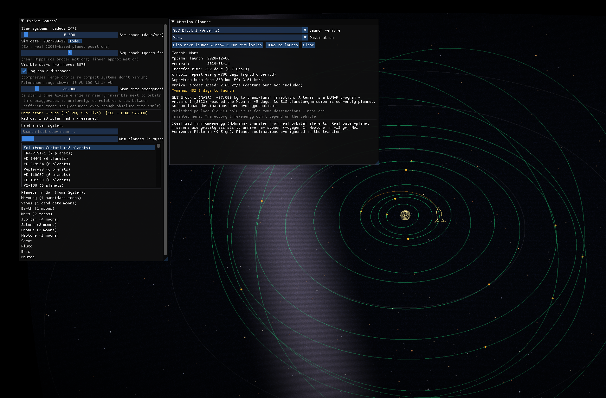

*Planning a Mars mission from a simulated date of September 2027. The
planner finds the next window (launch 2028-12-06, arrival 2029-08-14), a
252-day transfer at 3.61 km/s from low Earth orbit, with windows repeating
every ~780 days. The orange arc is the transfer orbit; log-scale distances
and reference rings (10 AU to 1,000 AU) are on.*

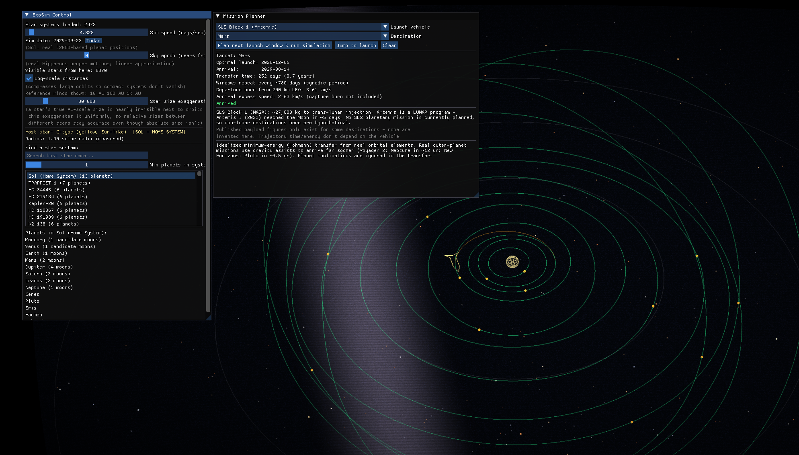

*The same mission, run forward past the arrival date. The spacecraft has
followed the arc to Mars's orbit, and the status reads "Arrived".*

### Flying the mission: follow the spacecraft and watch it land

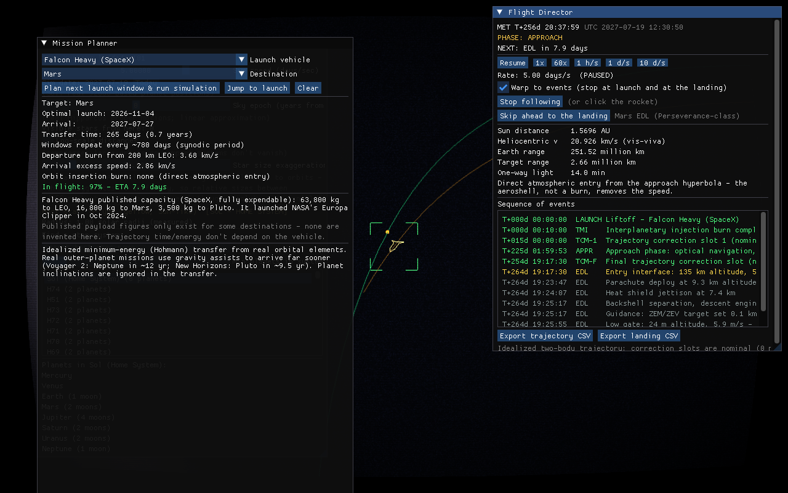

*Clicking the rocket locks the camera onto it. Here it is 97% of the way
to Mars (the yellow dot, 2.66 million km ahead). The Flight Director
shows mission elapsed time, the phase, live telemetry and a 14-minute
signal delay to Earth. Its sequence of events runs from liftoff through
every landing event.*

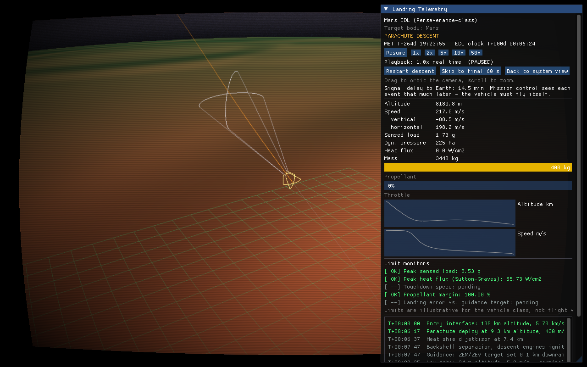

*At arrival the Landing view plays the descent in real time. The
capsule entered at 5.70 km/s, peaked at 8.5 g, and opened its parachute
at 9.3 km and 420 m/s (Perseverance: ~11 km). The orange line is the
flown path; limit monitors check load and heat flux against the vehicle
class's limits.*

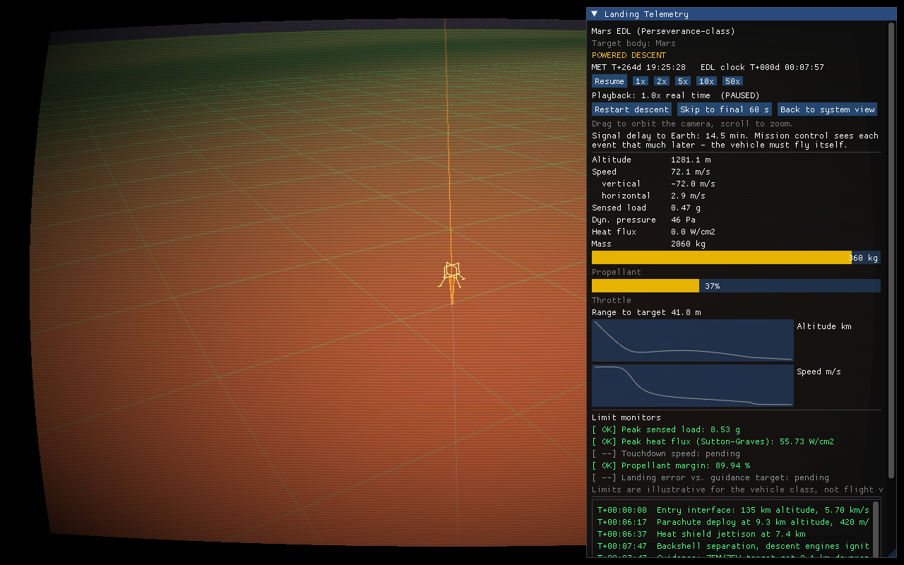

*After backshell separation at 2.1 km, the descent engines fly a
closed-loop ZEM/ZEV guidance law at 20 Hz. They null the horizontal
velocity and touch down at 0.75 m/s, 5 cm from the guidance target.*

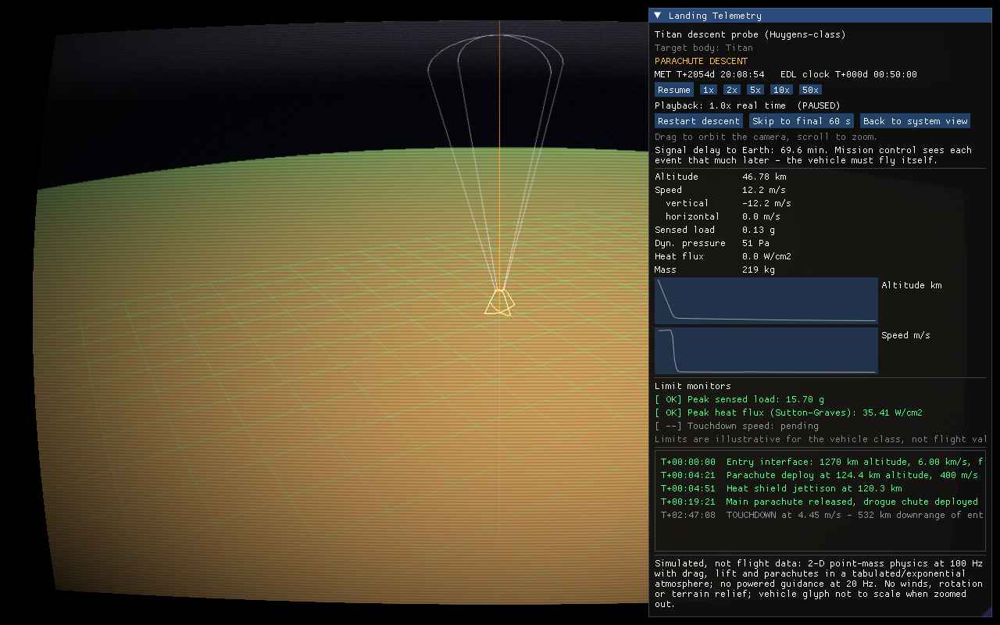

*Titan: a Huygens-class probe under its drogue parachute. The simulated
descent takes 2 h 47 min and touches down at 4.45 m/s (Huygens, 2005:
~2 h 27 min, ~4.5 m/s). The signal delay to Earth is 70 minutes.*

These four were rendered with `ExoSim --scenario <body> --edl-time <s>`
(or `--cruise <fraction>`) `--screenshot <file>` under software OpenGL.
That mode reproduces any moment of a mission exactly.

### Sol, the home system

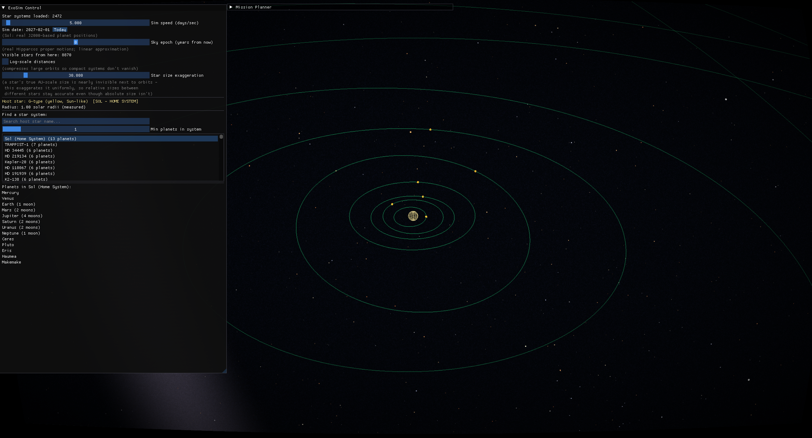

*Sol at true (linear) scale. The control panel shows the simulation date,
the 8,870 Hipparcos stars visible from Earth, the host star's measured
properties, and Sol's 13 bodies, including the five dwarf planets from
NASA/JPL's Small-Body Database.*

### An exoplanet multi-star system: Kepler-20

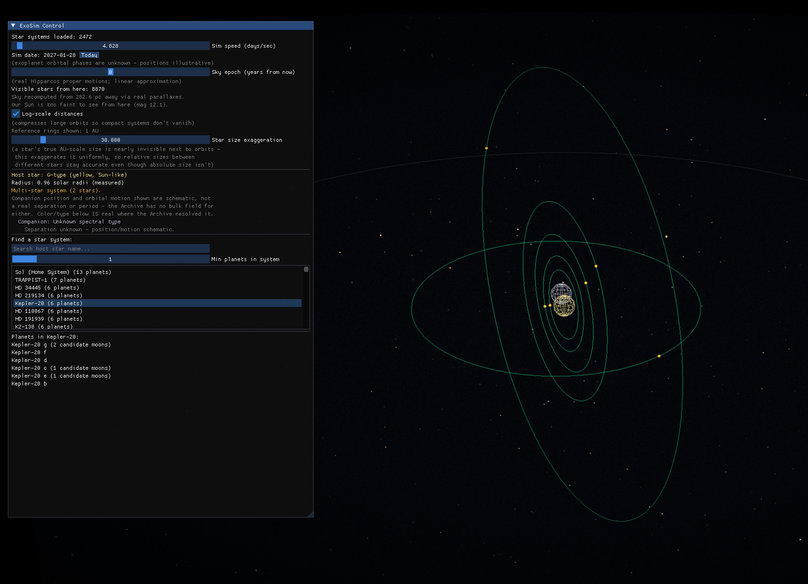

*Kepler-20, a real six-planet system 282.6 parsecs away. The panel flags
it as a two-star system and labels the companion's position and motion as
schematic, since the Archive has no separation for it. The starfield is
recomputed as it would appear from Kepler-20 using real parallaxes, and
the panel notes that our Sun is too faint to see from there (magnitude
12.1). Moons listed for these planets are labeled as candidates.*

### Startup: loading real data

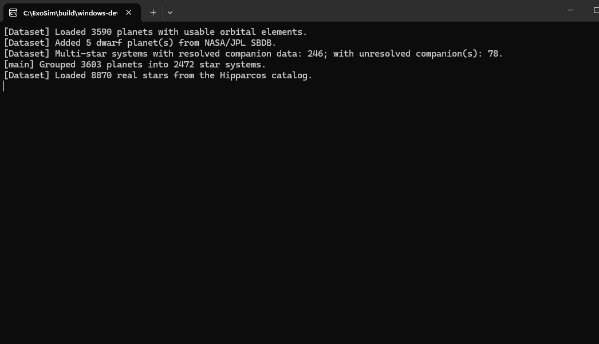

*Startup log. ExoSim loads 3,590 exoplanets with usable orbits, 5 dwarf
planets, companion data for 324 multi-star systems, and 8,870 stars, then
groups everything into 2,472 star systems.*

## CI and releases

`.github/workflows/build-and-release.yml` runs on every push and pull request:

1. **Static analysis:** clang-format check and clang-tidy (warnings as
   errors) over the core and tests.
2. **Linux:** the validation suite, the same suite under ASan + UBSan, and
   GLSL validation of every shader.
3. **Windows** (only if both pass):
   - builds the portable exe and runs the tests;
   - packages the zip (including `LICENSE`);
   - fails if the exe depends on any non-system DLL;
   - extracts the zip and runs `--selftest` from a different directory;
   - uploads the zip as a build artifact.

**To cut a release:**
1. Set `VERSION` in `CMakeLists.txt`.
2. Add a matching `## x.y.z` section to `CHANGELOG.md`.
3. Commit, then run `git tag vX.Y.Z` and `git push origin vX.Y.Z`.

The workflow refuses a tag that doesn't match the CMake version. It then
publishes a GitHub Release with the zip, taking the release notes from
that CHANGELOG section. `0.x` versions are marked as pre-releases.

## Known limitations

- **Two-body planets.** Standish's elements with secular rates are good to ~20–80″ for the inner planets over 1950–2050, but Jupiter and Saturn stay at ~550″ because their mutual perturbation isn't modeled. The table is valid only for 1800–2050.
- **Patched conics.** Transfers and flybys are impulsive and two-body within each sphere of influence. That's enough to find real launch dates, but C3 values match real missions only to ~15–30%. There are no deep-space maneuvers, and the moon tour after arrival at a giant planet is a placeholder.
- **The landing simulation is simplified.**
  - Physics: 2-D point mass on a non-rotating sphere, with no winds and no terrain relief.
  - Entry: ballistic, or full lift-up on Mars, not guided bank-angle control.
  - Vehicles: parameters are representative of a class, not exact.
- **Exoplanet orbital phases are unknown.** Orbit shapes and periods are real; positions along the orbit are not.
- **The Milky Way model is illustrative.** Host positions are real; the disk, bar, bulge and arms are a smooth model fitted to measured arm crossings, and the far side of the Galaxy is poorly known. 107 hosts (2%) have no distance in the Archive's default parameter set. The latest fetch script recovers most of them from the `stellarhosts` table.
- **Not flight software.** See [Requirements → Out of scope](docs/REQUIREMENTS.md#out-of-scope).

## Roadmap

The 0.7 roadmap (Lambert and porkchop plots, Horizons validation, replay and the `main.cpp` refactor, static analysis/config/logging, and gravity-assist chains) shipped in 0.8. Next, still favoring mission-analysis depth and engineering rigor:

1. **N-body ephemeris option.** Integrate the planets (or read DE440 directly) to remove the ~550″ Jupiter/Saturn limit.
2. **Deep-space maneuvers and launch-period analysis.** Multiple-shooting optimization on gravity-assist legs; launch period vs. C3 budget.
3. **MSVC in CI**, with tests and clang-tidy on Windows.
4. **Gaia DR3 distances** for host stars, with distance error bars on the Milky Way map.

## Documentation

| Document | Contents |
|---|---|
| [docs/VALIDATION.md](docs/VALIDATION.md) | Method, full results table, defects found, what isn't validated |
| [docs/ARCHITECTURE.md](docs/ARCHITECTURE.md) | Components, data flow, time systems and frames, assumptions, performance, refactor plan |
| [docs/DATA_SOURCES.md](docs/DATA_SOURCES.md) | Provenance, citations, required acknowledgments, dependency licenses |
| [docs/REQUIREMENTS.md](docs/REQUIREMENTS.md) | Requirements with verification traceability and status |
| [CHANGELOG.md](CHANGELOG.md) | Version history |

## Acknowledgments

This research has made use of the NASA Exoplanet Archive, which is
operated by the California Institute of Technology, under contract with
the National Aeronautics and Space Administration under the Exoplanet
Exploration Program. It has also made use of the VizieR catalogue access
tool, CDS, Strasbourg, France. The Hipparcos catalogue is © ESA (1997),
and the Washington Double Star Catalog is maintained by the US Naval
Observatory. Full citations are in [docs/DATA_SOURCES.md](docs/DATA_SOURCES.md).

## License

ExoSim's source code is released under the [MIT License](LICENSE).
Catalog data fetched or bundled from NASA, JPL, CDS/VizieR and others is
**not** covered by that license; it remains under each provider's terms
(see [docs/DATA_SOURCES.md](docs/DATA_SOURCES.md)).
