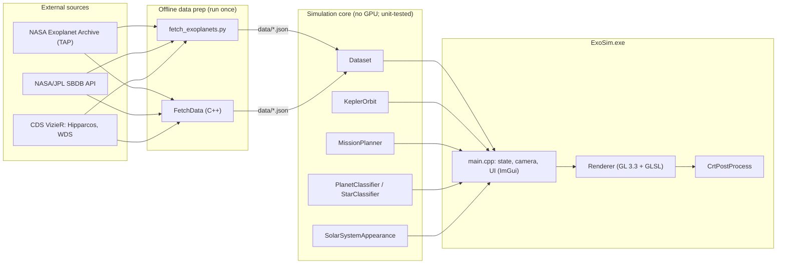

# Architecture

## Components

| Module | Responsibility | Depends on |
|---|---|---|
| `KeplerOrbit` | Solves Kepler's equation and propagates a two-body orbit to a position at time *t* | GLM |
| `MissionPlanner` | Hohmann transfers, launch-window search, patched-conic Δv, J2000↔calendar conversion | `KeplerOrbit` |
| `Dataset` | Loads and validates all JSON data, groups planets into systems, cross-matches double stars, provides Sol's built-in data | nlohmann/json |
| `PlanetClassifier` | Composition estimate from density / radius / mass, plus a curated table of published atmosphere detections | `Dataset` types |
| `StarClassifier` | Spectral class and display color from effective temperature | — |
| `SolarSystemAppearance` | Real, documented appearance of Sol's bodies (colors, features, axial tilt, real ring radii) | GLM |
| `Renderer` | All OpenGL drawing: orbits, stars, surfaces, rings, skybox, star catalog | glad, GLM |
| `CrtPostProcess` | Offscreen framebuffer and CRT composite shader | glad |
| `main.cpp` | Window, input, camera, simulation clock, UI panels, and orchestration | everything |
| `tools/fetch_data.cpp` | Optional C++ equivalent of the Python fetch script | libcurl, nlohmann/json |

The core modules have no OpenGL dependency, which is what lets
`ExoSimTests` exercise them without a GPU.

## Data flow

1. **Fetch (offline).** Either fetch tool queries four real sources and
   writes `data/*.json`. Neither is invoked by the app.
2. **Load (startup, ~0.5 s total; see Performance).** `Dataset` parses each
   file with type-checked field access. Malformed rows are skipped, and a
   missing file disables only the feature it feeds. Sol's 8 planets and
   their moons are built in, so the app always has real data to show.
3. **Group and enrich.** Planets are grouped by host star. Multi-star
   hosts are enriched from `stellar_hosts.json`, then cross-matched by sky
   position against the Washington Double Star catalog.
4. **Per frame.** `main.cpp` advances the simulation clock, propagates only
   the *selected* system's bodies through `KeplerOrbit`, and draws through
   `Renderer`. The CRT pass composites last, and ImGui draws on top.

## Time systems and reference frames

These definitions are exact statements of what the code does.

**Simulation time.** `simTimeDays` is a `double`: days since
**J2000.0 = 2000-01-01 12:00 TT (JD 2451545.0)**.
- It starts at the current date from the OS clock, then advances by
  wall-clock frame time × the sim-speed slider.
- The OS clock is UTC. The code treats UTC as if it were TT, ignoring
  TT − UTC = 69.184 s (≈0.0008 day). That is negligible against the
  model's own error (see `VALIDATION.md`).
- There is no distinction between TT and TDB, and no leap-second handling.

**Displayed date.** The UTC calendar date of `simTimeDays`, with no time of
day. It is computed with Howard Hinnant's civil-from-days algorithm.

**Sol (the planets).**
- Frame: **heliocentric** (Sun-centred, *not* solar-system barycentric),
  referred to the **mean ecliptic and equinox of J2000**.
- Elements: JPL's *Keplerian Elements for Approximate Positions of the
  Major Planets* (E. M. Standish), J2000 values, held **fixed**. The
  secular rates in that table are not applied.
- "Earth" is the Earth–Moon **barycentre**, as in Standish's table.

**Dwarf planets.** Osculating heliocentric J2000-ecliptic elements from
JPL SBDB. Their mean anomaly is propagated back from SBDB's epoch to J2000
as a two-body orbit.

**Moons.** Planet-centred, with published period, inclination and
eccentricity. Distances are compressed for display (see Assumptions).

**Exoplanet systems.**
- Frame: host-centred. The Archive's inclination is relative to the
  **plane of the sky**.
- Longitude of ascending node and mean anomaly at epoch are unknown for
  nearly all planets and are set to 0. As a result, **orbital phases are
  arbitrary**: shapes and periods are real, but where a planet sits on its
  orbit at a given date is not.

**Stars (skybox).**
- Hipparcos ICRS positions at the catalog epoch **J1991.25**.
- These are rotated into the ecliptic frame by the J2000 obliquity
  (23.4392911°) so they align with the planets' frame.
- Proper motion is applied **linearly** from J1991.25 to the current
  date, plus the sky-epoch slider.

**Render world.**
- y-up. Ecliptic (x, y, z) maps to world (x, z, −y), via a single
  function (`eclipticToWorld`) used everywhere.
- When a non-Sol system is selected, the observer sits at that host's real
  position (RA/Dec + distance). Stars with a parallax above 0.5 mas are
  re-projected in 3D from there.

## Key assumptions and their consequences

| Assumption | Consequence | Where it's surfaced |
|---|---|---|
| Two-body Keplerian motion (no N-body perturbations) | Accuracy degrades slowly away from J2000; excellent for 2024–2026 (measured) | `VALIDATION.md` |
| Hohmann transfers in the ecliptic plane | Minimum-energy, not fastest; ignores planet inclinations; outer-planet times far longer than real gravity-assist missions | Mission Planner HUD |
| Patched conics, point-mass targets | Capture burn and moon transfers not modeled | Mission Planner HUD |
| WDS separation is *projected* | A lower bound on the true separation, so companion periods are lower bounds | Companion HUD |
| Linear proper motion | Ignores radial velocity and perspective acceleration over long spans | Sky epoch label |
| Composition from density/radius/mass | Statistical estimate, never a measurement (except the curated published detections) | Planet Detail HUD |
| Procedural surfaces, and moon/star size exaggeration for visibility | Visualization choices, not data | HUD labels |

## Performance

Measured on one 2.8 GHz Xeon core, `-O2`, with synthetic data at real
dataset sizes. Rendering frame rate has not been measured here (no GPU).

| Operation | Size | Time |
|---|---|---|
| Load planets | 6,366 rows | ~73 ms |
| Group into systems | 3,183 systems | ~8.5 ms |
| Load star catalog | 9,000 stars | ~32 ms |
| Load + cross-match WDS | 150,000 pairs | 345–430 ms |
| One launch-window search | — | ~0.4 ms |
| Added peak memory | all of the above | ~61 MB |

Scaling notes:
- `GroupByHost` uses a hash map from host name to system (O(n)). It
  replaced a linear scan per row (O(n × systems)) in 0.6.0; at today's size
  that cut the time from ~26 ms to ~8.5 ms.
- WDS loading is dominated by JSON parsing. The cross-match itself uses a
  declination-sorted binary search.

## Coupling, and what I'd refactor first

`main.cpp` is the weak point. It owns application state, camera, input,
the simulation clock, all UI panels, and render orchestration, and
communicates through captured lambdas (`selectSystem`,
`rebuildStarField`). It works, but it is hard to test and review. The
planned split:

1. **`SimulationState`**: clock, selected system, and mission, with no GL
   or ImGui dependency, so it can be unit-tested.
2. **`SkyModel`**: the star-field reprojection (observer position,
   parallax, proper motion), which is pure math and testable.
3. **UI panels**: one class per window (control, detail, mission planner),
   reading `SimulationState`.
4. **Deterministic stepping**: advance the clock by fixed steps from a
   recorded input stream rather than wall-clock `dt`. This enables replay
   and regression tests of full sessions. **Today the simulation clock is
   not deterministic.**

The core modules are already decoupled from rendering, which is why they
could be unit-tested without changes.
