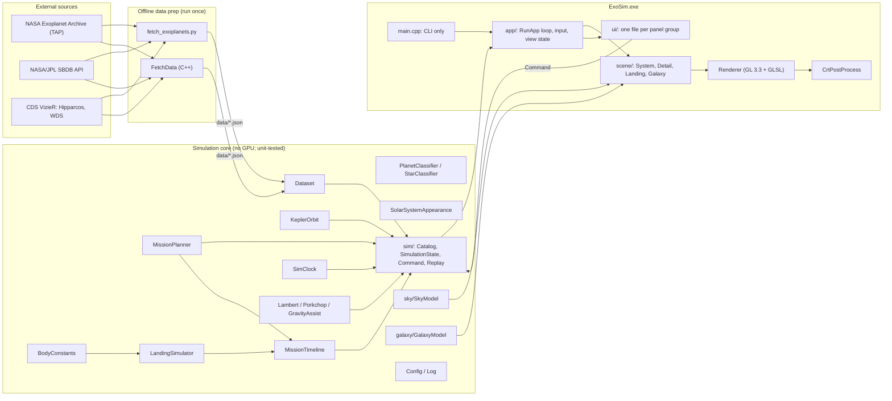

# Architecture

## Components

| Module | Responsibility | Depends on |
|---|---|---|
| `KeplerOrbit` | Solves Kepler's equation and propagates a two-body orbit to a position at time *t* | GLM |
| `MissionPlanner` | Hohmann transfers, launch-window search, patched-conic Δv, J2000↔calendar conversion | `KeplerOrbit` |
| `Dataset` | Loads and validates all JSON data, groups planets into systems, cross-matches double stars, provides Sol's built-in data | nlohmann/json |
| `PlanetClassifier` | Composition estimate from density / radius / mass, plus a curated table of published atmosphere detections | `Dataset` types |
| `StarClassifier` | Spectral class and display color from effective temperature | — |
| `SolarSystemAppearance` | Real, documented appearance of Sol's bodies (colors, features, axial tilt, real ring radii) | GLM |
| `BodyConstants` | GM, radius and atmosphere (exponential, or tabulated for Venus and Titan) for 23 Solar System bodies | — |
| `LandingSimulator` | Deterministic EDL simulation. RK4 physics at 100 Hz; guidance and control at 20 Hz with zero-order hold; a phase sequencer; ZEM/ZEV powered-descent guidance; limit checks; CSV telemetry | `BodyConstants` |
| `MissionTimeline` | Sequence of events, mission phase at any time, capture Δv, MET, light time, cruise state-vector export | `MissionPlanner`, `LandingSimulator` |
| `SimClock` | Fixed-tick (1/120 s) simulation clock with time warp and exact stops on events | — |
| `Lambert` | Universal-variable Lambert solver (Stumpff functions, bisection on z); state↔elements; universal Kepler propagation (elliptic and hyperbolic) | GLM |
| `Porkchop` | Launch/arrival grids of C3, v∞ and Δv from LEO; pattern-search refinement | `Lambert`, `KeplerOrbit` |
| `GravityAssist` | Patched-conic powered flyby chains: turn limit, periapsis burn, Laplace sphere of influence, SOI entry/exit times, sequence optimizer | `Lambert`, `Porkchop` |
| `sim/Catalog` | Everything loaded from `data/` (planets, orbits, systems, Hipparcos stars); immutable after load | `Dataset` |
| `sim/SimulationState` | Clock, selected system and planet, mission and timeline. Changed **only** by `apply(Command)`, so a session can be recorded and replayed; FNV-1a state hash | `Catalog`, `MissionPlanner`, `GravityAssist` |
| `sim/Replay` | JSON-lines recording (tick-stamped commands + final hash); `ReplayPlayer` steps a state one tick at a time | `SimulationState` |
| `sky/SkyModel` | The sky from any star system: parallax re-projection, proper motion, inverse-square brightness | `Dataset` |
| `galaxy/GalaxyModel` | Equatorial→Galactic conversion, host-star loading, the illustrative disk/bar/bulge/arm model | nlohmann/json, GLM |
| `Config` / `Log` | `exosim.json` settings with validation; structured logging (console + JSON lines) | nlohmann/json |
| `Renderer` | All OpenGL drawing: orbits, stars, surfaces, rings, skybox, star catalog, point clouds | glad, GLM |
| `CrtPostProcess` | Offscreen framebuffer and CRT composite shader | glad |
| `app/` | `RunApp` main loop, GLFW input callbacks, view and camera state (`AppContext`) | everything below |
| `scene/` | One renderer-facing scene per view: System, Detail, Landing, Galaxy | `Renderer`, `AppContext` |
| `ui/` | ImGui panels; they read state and change it only by issuing `Command`s | `AppContext` |
| `main.cpp` | Command-line parsing, config and logging setup, dispatch | `app/` |
| `tools/fetch_data.cpp` | Optional C++ equivalent of the Python fetch script | libcurl, nlohmann/json |

The core modules (everything above `Renderer`) are built as the
`ExoSimCore` static library with no OpenGL dependency. `ExoSimTests` and
the app both link it, which is what lets the tests exercise them without a GPU.

## Data flow

1. **Fetch (offline).** Either fetch tool queries four real sources and
   writes `data/*.json`. Neither is invoked by the app.
2. **Load (startup, ~0.5 s total; see Performance).** `Dataset` parses each
   file with type-checked field access. Malformed rows are skipped, and a
   missing file disables only the feature it feeds. Sol's 8 planets and
   their moons are built in, so the app always has real data to show.
3. **Group and enrich.** Planets are grouped by host star. Multi-star
   hosts are enriched from `stellar_hosts.json`, then cross-matched by sky
   position against the Washington Double Star catalog.
4. **Per frame.** `main.cpp` advances the simulation clock, propagates only
   the *selected* system's bodies through `KeplerOrbit`, and draws through
   `Renderer`. The CRT pass composites last, and ImGui draws on top.

## Time systems and reference frames

These definitions are exact statements of what the code does.

**Simulation time.** `simTimeDays` is a `double`: days since
**J2000.0 = 2000-01-01 12:00 TT (JD 2451545.0)**.
- It starts at the current date from the OS clock, then advances by
  wall-clock frame time × the sim-speed slider.
- The OS clock is UTC. The code treats UTC as if it were TT, ignoring
  TT − UTC = 69.184 s (≈0.0008 day). That is negligible against the
  model's own error (see `VALIDATION.md`).
- There is no distinction between TT and TDB, and no leap-second handling.

**Displayed date.** The UTC calendar date of `simTimeDays`, with no time of
day. It is computed with Howard Hinnant's civil-from-days algorithm.

**Sol (the planets).**
- Frame: **heliocentric** (Sun-centred, *not* solar-system barycentric),
  referred to the **mean ecliptic and equinox of J2000**.
- Elements: JPL's *Keplerian Elements for Approximate Positions of the
  Major Planets* (E. M. Standish), J2000 values, held **fixed**. The
  secular rates in that table are not applied.
- "Earth" is the Earth–Moon **barycentre**, as in Standish's table.

**Dwarf planets.** Osculating heliocentric J2000-ecliptic elements from
JPL SBDB. Their mean anomaly is propagated back from SBDB's epoch to J2000
as a two-body orbit.

**Moons.** Planet-centred, with published period, inclination and
eccentricity. Distances are compressed for display (see Assumptions).

**Exoplanet systems.**
- Frame: host-centred. The Archive's inclination is relative to the
  **plane of the sky**.
- Longitude of ascending node and mean anomaly at epoch are unknown for
  nearly all planets and are set to 0. As a result, **orbital phases are
  arbitrary**: shapes and periods are real, but where a planet sits on its
  orbit at a given date is not.

**Stars (skybox).**
- Hipparcos ICRS positions at the catalog epoch **J1991.25**.
- These are rotated into the ecliptic frame by the J2000 obliquity
  (23.4392911°) so they align with the planets' frame.
- Proper motion is applied **linearly** from J1991.25 to the current
  date, plus the sky-epoch slider.

**Render world.**
- y-up. Ecliptic (x, y, z) maps to world (x, z, −y), via a single
  function (`eclipticToWorld`) used everywhere.
- When a non-Sol system is selected, the observer sits at that host's real
  position (RA/Dec + distance). Stars with a parallax above 0.5 mas are
  re-projected in 3D from there.

## Key assumptions and their consequences

| Assumption | Consequence | Where it's surfaced |
|---|---|---|
| Two-body Keplerian motion (no N-body perturbations) | Accuracy degrades slowly away from J2000; excellent for 2024–2026 (measured) | `VALIDATION.md` |
| Hohmann transfers in the ecliptic plane | Minimum-energy, not fastest; ignores planet inclinations; outer-planet times far longer than real gravity-assist missions | Mission Planner HUD |
| Patched conics, point-mass targets | Capture is one impulsive burn at periapsis; the tour from a parent planet to its moon is not modeled | Mission Planner / Flight Director HUD |
| 2-D point-mass EDL on a non-rotating sphere; ballistic or full lift-up entry; class-representative vehicles | Descent profiles are representative, not mission-accurate: no winds, no terrain, no guided bank angle | Landing Telemetry HUD |
| Single-exponential atmospheres (tabulated for Venus and Titan) | Density errors at altitude change where parachutes open; tabulated profiles fix the two worst cases | `BodyConstants.cpp` |
| WDS separation is *projected* | A lower bound on the true separation, so companion periods are lower bounds | Companion HUD |
| Linear proper motion | Ignores radial velocity and perspective acceleration over long spans | Sky epoch label |
| Composition from density/radius/mass | Statistical estimate, never a measurement (except the curated published detections) | Planet Detail HUD |
| Procedural surfaces, and moon/star size exaggeration for visibility | Visualization choices, not data | HUD labels |

## Performance

Measured on one 2.8 GHz Xeon core, `-O2`, with synthetic data at real
dataset sizes. Rendering frame rate has not been measured here (no GPU).

| Operation | Size | Time |
|---|---|---|
| Load planets | 6,366 rows | ~73 ms |
| Group into systems | 3,183 systems | ~8.5 ms |
| Load star catalog | 9,000 stars | ~32 ms |
| Load + cross-match WDS | 150,000 pairs | 345–430 ms |
| One launch-window search | — | ~0.4 ms |
| Added peak memory | all of the above | ~61 MB |

Scaling notes:
- `GroupByHost` uses a hash map from host name to system (O(n)). It
  replaced a linear scan per row (O(n × systems)) in 0.6.0; at today's size
  that cut the time from ~26 ms to ~8.5 ms.
- WDS loading is dominated by JSON parsing. The cross-match itself uses a
  declination-sorted binary search.

## Coupling: how the 0.8 refactor split `main.cpp`

Through 0.7, `main.cpp` owned application state, the camera, input, the
clock, every UI panel and render orchestration (~2,000 lines, talking
through captured lambdas). In 0.8 it is ~150 lines of CLI parsing, and the
rest is split by responsibility:

1. **`SimulationState`** (`sim/`): clock, selected system, mission,
   timeline. No GL or ImGui. Its only mutator is `apply(Command)`, and
   `advance(dt)` steps the fixed-tick clock, stopping on mission events.
2. **`SkyModel`** (`sky/`) and **`GalaxyModel`** (`galaxy/`): pure math,
   unit-tested (ENG, GAL groups).
3. **Scenes** (`scene/`): one per view. Derived geometry is rebuilt by
   change detection (`syncWithState`), so a system change from a replay
   updates the view exactly as a click would.
4. **UI panels** (`ui/`): read `SimulationState`, write only through
   `Command`s, which is what makes recording possible.
5. **Recorded-input replay** (`sim/Replay`): commands are stamped with
   the clock tick they were applied at; playback re-applies them at the
   same ticks and compares an FNV-1a hash of the final state
   (`--verify-replay`, ENG-1…8).

The refactor was verified by rendering 12 reference views with the
deterministic screenshot mode before and after the split: all 12 were
pixel-identical.

What would come next: the remaining presentation state (`ViewState`,
`CameraState`) is plain structs, which is fine at this size. Moving the
porkchop grid computation off the UI thread would be the next step if
grids got larger.
